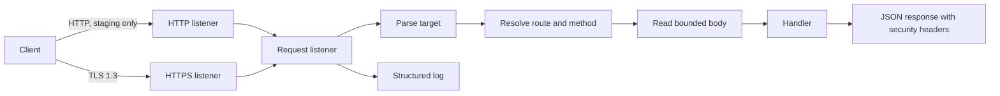
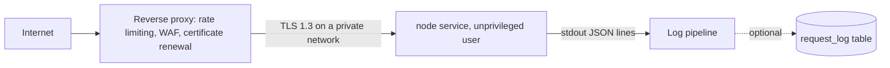

# Architecture

## Overview

The service is a single Node.js process with no runtime dependencies. It opens one or two listeners that share a single request pipeline.



## Module structure

```text
src/
├── main.js                          Composition root and signal handling
├── app/
│   └── create-application.js        Listeners, server limits, start and stop
├── config/
│   └── load-config.js               Environment parsing and validation
├── http/
│   ├── create-request-listener.js   Request pipeline and error mapping
│   ├── http-error.js                Typed client-facing errors
│   ├── parse-request-target.js      Path normalization and query parsing
│   ├── read-body.js                 Size-limited UTF-8 body reader
│   └── send-json.js                 Serialization and security headers
├── routing/
│   ├── build-routes.js              Route table per configuration
│   └── create-router.js             Map-based lookup
├── handlers/
│   ├── mirror.js
│   ├── ping.js
│   └── sample.js
├── security/
│   ├── load-tls-credentials.js
│   └── redact-headers.js
└── observability/
    └── create-logger.js             JSON-lines logger
test/
├── unit/                            Pure module tests
├── integration/                     Real-socket HTTP, TLS, and process tests
└── support/                         Harness and ephemeral certificates
```

Dependencies point inward: `main` composes `app`, `app` composes `http` and `routing`, and `routing` composes `handlers`. Handlers receive a plain request object and return a plain result, so they can be tested without a socket.

## Request lifecycle

1. Generate a server-side request id. Client-supplied ids are ignored.
2. Parse the target, rejecting anything that is not origin-form.
3. Resolve the route through a `Map`, then check the method.
4. Read the body only for routes that declare `readsBody`.
5. Run the handler and send JSON with the security headers.
6. Map failures to a typed error. Unexpected errors become a generic `500`.
7. Log one metadata-only event when the response closes.

## Key decisions

| Decision | Reason |
| --- | --- |
| No runtime dependencies | The scope needs none, and it leaves no third-party supply chain to patch |
| `Map` for routes | Lookups cannot reach inherited object properties |
| Fail-closed configuration | A mistyped environment must not silently enable staging behavior |
| Mirror disabled in production | Echo endpoints are diagnostic tools |
| HTTPS only in production | Plaintext is limited to local development |
| JSON-lines logs | Machine-readable, and encoding neutralizes log injection |

## Recommended deployment



Rate limiting and certificate renewal belong in the proxy. The optional `db/schema.sql` matches the `request_completed` event, and the service itself never connects to a database.
